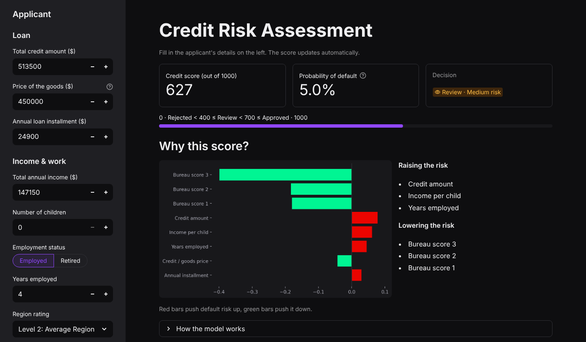
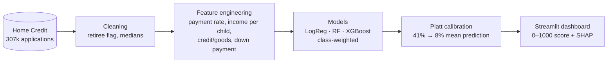

# End-to-End Credit Scoring

Live Demo: https://credit-score-assessment.streamlit.app/

A machine learning pipeline that predicts whether a loan applicant will default, from
raw data to an interactive dashboard. It is trained on Kaggle's
[Home Credit Default Risk](https://www.kaggle.com/competitions/home-credit-default-risk)
dataset (about 307,000 applications, 8% of which defaulted) and served through a
**Streamlit** app that turns the model's probability into a 0–1000 credit score.

<p align="center">
  
  <br><sub>The dashboard: the score, the calibrated probability of default, the decision band, and a SHAP
  explanation of which inputs push this applicant's risk up or down.</sub>
</p>



## Results

Defaulters are the minority class, so the models are trained with class weighting and
judged by **recall on defaulters**: missing a borrower who will default costs more
than sending a good one to manual review. Evaluated on a 20% hold-out set
(61,503 applications):

| Model | Recall (default) | Precision (default) | Accuracy |
|---|---|---|---|
| Logistic Regression | 0.65 | 0.15 | 0.68 |
| Random Forest | 0.62 | 0.16 | 0.71 |
| **XGBoost (deployed)** | **0.66** | **0.16** | **0.70** |

XGBoost catches two out of every three defaulters while still approving 70% of good borrowers.
Low precision on the default class is expected at an 8% base rate: the model is meant
to flag applications for review, not to reject them automatically. Its **ROC-AUC is 0.746**.

## Pipeline

All of the analysis lives in [`notebooks/notebook.ipynb`](notebooks/notebook.ipynb).

1. **Exploratory analysis.** Correlation of every numeric feature with default, and
   distributions of age, employment length, income, credit amount and annuity.
2. **Data cleaning.** The dataset encodes retirees as `DAYS_EMPLOYED = 365243`. Instead
   of imputing those with the median (which would give retirees 4–5 years of fake work
   history), they become `0` years employed plus an explicit `IS_RETIRED` flag.
   Remaining missing values are filled with the median.
3. **Feature engineering.** Ratios that describe a borrower's financial situation better
   than raw amounts:
   - **Payment rate:** annual installment over income.
   - **Income per child:** income adjusted for family size.
   - **Credit/goods ratio** and **down payment:** how much of the purchase is financed.
4. **Modeling.** Logistic Regression, Random Forest and XGBoost, all with class
   weighting for the imbalance (`class_weight='balanced'`, `scale_pos_weight`).
   XGBoost is trained on the raw (unscaled) features: trees don't need scaling, and the
   dashboard feeds it raw values, so training and serving see the same inputs.
5. **Calibration.** Class weighting makes the model count each default ~11 times, which
   inflates its probabilities (average prediction 41% vs. a real default rate of 8%).
   A Platt scaler fitted on the logit of the predictions, using half of the hold-out set
   and evaluated on the other half, brings them back to real frequencies:

   | | ROC-AUC | Brier score | Mean predicted default |
   |---|---|---|---|
   | Raw model | 0.747 | 0.196 | 41.2% |
   | **Calibrated** | 0.747 | **0.068** | **8.0%** (real: 8.05%) |

   Calibration doesn't change the ranking of applicants, only how the probability reads.
6. **Scoring.** The dashboard maps the model's raw probability linearly onto a
   0–1000 score, and shows the calibrated probability of default next to it.

## Dashboard

```bash
pip install -r requirements.txt
streamlit run src/app.py
```

- Enter an applicant's details in the sidebar and the score updates instantly. Inputs
  start at the dataset's median applicant.
- **700+** approved (low risk), **400–699** manual review, **below 400** rejected.
- The calibrated **probability of default** is shown next to the score.
- A **SHAP** chart explains each individual score: which inputs push the risk up and
  which push it down. A global feature-importance chart is available below it.
- Dark theme with a Twitch-inspired palette (`.streamlit/config.toml`).

The trained model is included in `models/credit_score_model.pkl`, so the dashboard
runs without the dataset. To re-run the notebook, download `application_train.csv`
from Kaggle into `data/home-credit-default-risk/` (you need to accept the competition
rules on Kaggle first).

## Tech stack

Python, pandas, NumPy, scikit-learn, XGBoost, SHAP, Streamlit, Matplotlib, Seaborn.
